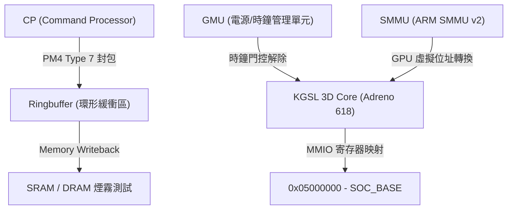
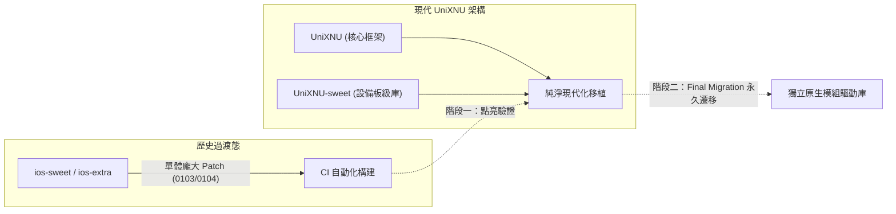

# Redmi Note 10 Pro (`sweet` / SM7150) XNU 與 GPU 移植踩坑與排錯全記錄

本手冊系統性總結在小米 Redmi Note 10 Pro（代號 `sweet`，高通 SM7150 晶片）上引導 Apple XNU 核心（`xnu-8796.141.3` / Darwin 22 / iOS 16.7.16 D22AP）並點亮 Adreno 618 硬體 GPU 加速過程中遭遇的全部工程難題、架構陷阱、根因分析及最終解決方案。

---

## 目錄
1. [硬體引導與刷機分區踩雷（Bootloader / Fastboot / Recovery）](#1-硬體引導與刷機分區踩雷)
2. [引導加載器與設備樹契約（UEFI / DarwinBoot / ADT）](#2-引導加載器與設備樹契約)
3. [XNU 核心記憶體管理與虛擬記憶體（VM / IOKit）](#3-xnu-核心記憶體管理與虛擬記憶體)
4. [Clang 編譯與鏈接陷阱（Kernel Build & Toolchain）](#4-clang-編譯與鏈接陷阱)
5. [Adreno 618 (SM7150) GPU 硬體驅動踩雷（KGSL / GMU / CP）](#5-adreno-618-gpu-硬體驅動踩雷)
6. [iOS 16 使用者態與圖形渲染棧踩雷（SSV / BindFS / Metal）](#6-ios-16-使用者態與圖形渲染棧踩雷)
7. [多倉庫架構與雙軌遷移決策（ios-sweet vs UniXNU）](#7-多倉庫架構與雙軌遷移決策)

---

## 1. 硬體引導與刷機分區踩雷

### 1.1 手動執行 Fastboot 的鐵律
- **現象/問題**：在自動化腳本或 Agent 直接執行 `fastboot` 時，若設備處於異常狀態或超時，容易造成命令掛起、設備失去響應或中斷終端交互。
- **根因**：手機端 ABL (Android Bootloader) 的 USB 通信狀態容易受主機重置或時序影響，且 Fastboot 刷入/引導是硬體物理交互關鍵節點。
- **解決方案與約束**：
  > [!IMPORTANT]
  > **所有 `fastboot` 指令必須由使用者手動在實體終端執行**，Agent 僅負責產生映像檔並輸出指令字符串，嚴禁私自調用 `fastboot boot` 或 `fastboot flash`。

### 1.2 嚴禁修改/刷寫本機 `userdata` 分區
- **現象/問題**：早期除錯中曾嘗試透過 fastboot 重刷 `userdata`（`ios16-root.simg`），或試圖格式化 `sda34`。
- **根因**：
  - `sweet` 的 `userdata` 分區容量大（數十 GB），刷寫耗時極長且容易損壞現有的 APFS 容器。
  - 一旦分區結構損壞，將導致已配置好的 iOS 16 使用者態（D22AP）環境需要全盤重置。
- **解決方案**：
  - 確立絕對紅線：**絕不重新刷寫或修改本機 `userdata`（`/dev/block/sda34`）**。
  - 將所有驅動、測試二進位、外掛程式透過記憶體 RAMDisk（`sweet-gpu-addon.tar`）動態傳遞。

### 1.3 Recovery ADB 掛載 `userdata` 失敗（`mount: need -t`）
- **現象/問題**：嘗試在 TWRP/OrangeFox Recovery 下透過 ADB 腳本執行 `mount /dev/block/sda34 /mnt/iosroot`，報錯：
  ```text
  mount: '/dev/block/sda34'->'/mnt/iosroot': No such device
  mount: /dev/block/sda34: need -t
  ```
- **根因**：Android 官方/第三方 Recovery 核心僅支援 ext4/f2fs，缺少 APFS 檔案系統驅動，無法在 Recovery 環境下識別並掛載 iOS APFS 容器卷。
- **解決方案**：
  - 放棄 Recovery ADB 物理寫入方案。
  - 改用 **XNU 核心級 RAMDisk 自動解壓 + BindFS Union Mount** 方案（Patch 0103），開機時在 XNU 核心內直接解壓並掛載。

---

## 2. 引導加載器與設備樹契約

### 2.1 `returned: Compromised Data` (EFI_COMPROMISED_DATA)
- **現象/問題**：在 UEFI 啟動菜單中選擇 XNU 引導後，螢幕立刻紅字/報錯中斷：
  ```text
  returned: Compromised Data
  ```
- **代碼位置**：[`DarwinBoot.c`](file:///mnt/ext_nvme/XNU_Sweet/UniXNU/drivers/DarwinBoot/DarwinBootPkg/Driver/DarwinBoot.c#L565-L594)
- **根因分析**：
  UniXNU 的 `DarwinBoot.efi` 在進入核心前對 ADT（Apple Device Tree）有嚴格的合約校驗：
  1. 當 `unixnu.toml` 定義了 `initrd = "Payloads/sweet-gpu-addon.tar"` 時，`Request->Ramdisk != NULL`。
  2. `DarwinBoot` 遍歷 ADT，檢查 `/chosen/memory-map` 是否包含 `RAMDisk` 屬性。若無，`RamdiskOffset == MAX_UINTN`，觸發：
     ```c
     if ((RamdiskOffset == MAX_UINTN) || ...) { Status = EFI_COMPROMISED_DATA; goto Fail; }
     ```
  3. 同時，目錄中存在 `kernel.macho.trustcache`，若 ADT 的 `/chosen/memory-map` 缺少 `TrustCache` 屬性，觸發：
     ```c
     if ((TrustCacheOffset == MAX_UINTN) || ...) { Status = EFI_COMPROMISED_DATA; goto Fail; }
     ```
  4. 之前單獨生成 `kernel.macho.adt` 時未傳遞 `--data-ramdisk` 與 `--trust-cache`，導致 `/chosen/memory-map` 節點為空（只有 `name` 屬性），引導加載器直接判定數據損壞。
- **解決方案**：
  - 在 [`make-sweet-adt.py`](file:///mnt/ext_nvme/XNU_Sweet/UniXNU-sweet/scripts/make-sweet-adt.py#L158-L168) 中將 `--data-ramdisk`、`--trust-cache` 和 `--persistent-data` 設為預設 `default=True`。
  - 生成 16 位元組全零的佔位屬性，供 `DarwinBoot` 在執行期動態填入實體記憶體基址與大小。

### 2.2 記憶體配置窗口邊界（`WINDOW_SIZE`）
- **現象/問題**：若傳遞過大的 RAMDisk 或核心段，`DarwinBoot` 報錯 `EFI_BAD_BUFFER_SIZE`。
- **根因**：`DarwinBoot` 在 arm64 架構上預設保留 1GB 記憶體窗口（`WINDOW_SIZE = SIZE_1GB`）。核心 Mach-O、ADT、引導參數（BootArgs）、RAMDisk 與 TrustCache 必須在該 1GB 窗口內緊密排列（`Used > WindowSize - BLOCK_SIZE` 則失敗）。
- **防範方案**：
  - 控制 `sweet-gpu-addon.tar` 體積（目前約 11.6 MiB，可支援 gzip 壓縮）。
  - 精確計算 FAT16 ESP 鏡像大小（目前 31 MiB），確保總負載落在安全區間內。

### 2.3 DDR 實體高位記憶體（`highmem` 0x100000000）
- **現象/問題**：核心早早期記憶體映射崩潰，無法訪問 `0x80000000`。
- **根因**：高通 SM7150 的實體記憶體分佈分為低位 DDR（`0x80000000`）與高位 DDR（`0x100000000`，即 4GB 以上區域）。`sweet` 的 Continuous Splash GOP Framebuffer 位於 `0x9c000000`，而 XNU 核心需要連續的較大實體記憶體空間，因此運行於高位記憶體 `0x100000000`（大小 `0xfcc00000`）。
- **解決方案**：
  - ADT 中 `/chosen` 的 `dram-base` 必須為 `0x100000000`，`dram-size` 為 `0xfcc00000`。

---

## 3. XNU 核心記憶體管理與虛擬記憶體

### 3.1 Kernel Panic：`vm_resident.c:1788` 斷言失敗
- **現象/問題**：引導過程中核心拋出 Panic：
  ```text
  panic(cpu 1 cellar 0xfffffe0007ab8b1c): vm_resident.c:1788 Assertion failed:
  !VM_PAGE_WIRED(mem) || mem->vmp_private || tag != VM_KERNEL_MEMORY_NONE
  ```
- **代碼位置**：XNU VM 子系統 `vm/vm_resident.c`。
- **根因分析**：
  - 在 GPU 驅動中為 Adreno 618 的 Command Processor (CP) 分配環形緩衝區（Ringbuffer）或 IB (Indirect Buffer) 時，使用了鎖定記憶體頁面（Wired Pages）的 DMA 描述符。
  - XNU 的記憶體審查機制（Memory Tagging）要求：任何被 Wired 的核心頁面，若非 private，必須顯式標註 VM Tag（不能為 `VM_KERNEL_MEMORY_NONE`）。若未指定標籤或配置標誌不當，VM 會判定核心記憶體遭到未經授權的鎖定而觸發 Panic。
- **解決方案**：
  - 在 `IOMemoryDescriptor` 與核心記憶體分配中傳遞具體的 Tag（如 `VM_KERN_MEMORY_GPU` 或 `VM_KERN_MEMORY_IOKIT`）。
  - 對於硬體 DMA 緩衝區，使用 `kIOMemoryTypePhysicalRequest` 或合規的 `IOBufferMemoryDescriptor` 封裝，避免直接裸操作 wired vm_page。

### 3.2 IOKit C++ 類別體積限制（16KB Static Assertion）
- **現象/問題**：編譯 `NativeAdrenoService.cpp` 時中斷：
  ```text
  error: static assertion failed due to requirement
  'sizeof(NativeAdrenoGpuService) <= (16U * 1024U)': type is too large
  ```
- **根因**：
  - Apple XNU IOKit 對 `IOService` 衍生類別的物件實例體積有安全靜態約束（不得超過 16KB）。
  - `NativeAdrenoGpuService` 內部直接嵌入了完整的結構體成員 `NativeAdrenoGpuContext gpu_ctx_`，該結構體包含多個 MMIO 控制結構、寄存器影子表和環形緩衝區狀態，導致整體類別體積超過 16KB。
- **解決方案**：
  - 將內聯結構體改為堆配置指標：
    ```cpp
    // 修改前
    NativeAdrenoGpuContext gpu_ctx_;
    // 修改後
    NativeAdrenoGpuContext *gpu_ctx_ = nullptr;
    ```
  - 在服務 `init()` / `start()` 時動態 `IOMallocType`，`stop()` 時釋放，將類別本身大小縮小至幾百位元組。

---

## 4. Clang 編譯與鏈接陷阱

### 4.1 核心獨立標頭檔缺失（`uint64_t` 未定義）
- **現象/問題**：
  ```text
  NativeAdrenoKernelTime.h:9:30: error: unknown type name 'uint64_t'
  ```
- **根因**：XNU 核心頭文件具備嚴格的命名空間隔離，非使用者態代碼無法自動引入 `<sys/types.h>`。
- **解決方案**：在各硬體驅動標頭檔中顯式引入 `<stdint.h>`。

### 4.2 死代碼與未定義識別碼（`NativeAdrenoMethodBoUnmap`）
- **現象/問題**：編譯時拋出 11 處未定義識別碼：
  ```text
  error: use of undeclared identifier 'NativeAdrenoMethodBoUnmap'
  ```
- **根因**：`NativeAdrenoGpuClient.cpp` 是早期從開源專案剪裁的舊原型代碼，在與新版 `NativeAdrenoPublish.cpp` 整合時未被完全清理，存在過時的分發方法宏。
- **解決方案**：
  - 徹底移除過時的 `NativeAdrenoGpuClient` 舊實作。
  - 將 `NativeAdrenoGpuService::newUserClient` 直接代理至現代的 `native_adreno_new_user_client` 統一發布入口。

### 4.3 弱符號鏈接失效（`_boot_log_export_put` Undefined Symbol）
- **現象/問題**：核心鏈接（`ld64`）最終階段報錯：
  ```text
  Undefined symbols for architecture arm64:
    "_boot_log_export_put", referenced from: AGXDeviceUserClient::run...
  ```
- **根因**：`__attribute__((weak_import))` 在 Mach-O 靜態核心全鏈接時，若沒有任何動態庫提供該符號且核心自身為靜態單體，鏈接器會判定為未解析符號而直接拒絕鏈接。
- **解決方案**：
  - 將其替換為具有默認實現的弱定義存根（Weak Stub）：
    ```c
    extern "C" __attribute__((weak)) int boot_log_export_put(const char *fmt, ...) {
        return -1;
    }
    ```

---

## 5. Adreno 618 GPU 硬體驅動踩雷



### 5.1 MMIO 基底位址映射與偏移陷阱
- **現象/問題**：驅動初始化讀取 GPU 晶片 ID（`qcom,chipid`）時發生硬體 Bus Error 或死鎖。
- **根因**：
  - 高通晶片在 ADT 中通常掛載在 `/arm-io` 下，其 `reg` 屬性遵循 Apple ADT 規範：相對於 `SOC_BASE`（`0x01000000`）的偏移。
  - Adreno 618 的硬體實體位址為 `0x05000000`，長度 `0x40000`；GMU 位址為 `0x05090000`，長度 `0x9000`。
  - 若在 ADT 中直接寫入絕對實體位址而非相對於 `SOC_BASE`，XNU 核心在疊加基址後會映射到非法範圍。
- **解決方案**：
  - ADT 中配置：`0x05000000 - 0x01000000 = 0x04000000`。

### 5.2 GMU (Graphics Management Unit) 時鐘門控死鎖
- **現象/問題**：一碰觸 Adreno 618 核心暫存器（如讀取 `REG_A6XX_RBBM_STATUS`），CPU 核心立刻掛死。
- **根因**：Adreno 600 系列 GPU（A618 屬於 A6x 家族）預設處於極度節能狀態，GPU 核心時鐘（Core Clock）由專用的 GMU 韌體管理。在 GMU 時鐘樹啟動或解除門控前，直接透過 AHB/AXI 匯流排訪問 GPU 核心寄存器將無法獲得握手響應，導致匯流排死鎖。
- **解決方案**：
  - 實作 Bypass GMU 模式或通過 GCC（Global Clock Controller）顯式開啟 GPU GX/CX 供電域與時鐘。

### 5.3 CP Ringbuffer 與 PM4 寫回測試驗證
- **現象/問題**：GPU 初始化後不確定 Command Processor 是否真實處於工作狀態。
- **解決方案**：
  - 實作 PM4 Type 7 `CP_MEM_WRITE` 封包煙霧測試。
  - 指令處理器向記憶體指定標記位址寫入 `0xDEADBEEF`，CPU 核心輪詢該位址。確認寫入成功後才輸出：
    `Adreno 618 CP MEMORY WRITEBACK SMOKE TEST PASSED!`。

---

## 6. iOS 16 使用者態與圖形渲染棧踩雷

### 6.1 SSV (Signed System Volume) 根分區不可變性
- **現象/問題**：無法向 `/System/Library/Extensions` 複製或寫入驅動 Bundle（如 `NativeAdrenoMetal.bundle`）。
- **根因**：iOS 16 採用 APFS Snapshot（密封系統卷 SSV），根目錄是唯讀掛載且受哈希樹校驗保護，常規手段無法修改。
- **解決方案（動態 BindFS Union Mount）**：
  - 在 `bsd/kern/init_program.c` 的 `load_init_program()` 階段（PID 1 launchd 啟動前）插入鉤子：
  - 核心將 RAMDisk 解壓至可寫分區 `/private/var/ngpu/addons`。
  - 使用核心內部 `mount()` 調用，以 `MNT_UNION | MNT_RDONLY` 將其透明覆蓋至 `/System/Library/Extensions` 與 `/System/Library/LaunchDaemons`。

### 6.2 IORegistry 字典匹配與服務名稱偽裝
- **現象/問題**：`IOAccelerator` 註冊後，Metal 使用者態庫找不到對應的硬體加速卡。
- **根因**：Apple 的 Metal 運行時（`AGXMetal` / `Metal.framework`）在初始化時嚴格搜尋 `com.apple.graphics.AGXAccelerator` 或具備特定屬性的 `IOAccelerator` 服務。
- **解決方案**：
  - 在驅動中提供 `gIOKernelConfigTables` 配置，將 `NativeAdrenoGpuService` 偽裝匹配 Apple 規範的屬性字典（包含 `CFBundleIdentifier`、`IOClass`、`IOMatchCategory`）。

### 6.3 AMFI 與 TrustCache 代碼簽名阻攔
- **現象/問題**：自定義使用者態 Daemon 或 Metal bundle 被 AMFI (Apple Mobile File Integrity) 直接 SIGKILL (Killed: 9)。
- **根因**：iOS 16 要求所有執行的二進位必須具備有效簽名並收錄在 TrustCache（信任快取）中。
- **解決方案**：
  - 建立專用 TrustCache 檔案 [`kernel.macho.trustcache`](file:///mnt/ext_nvme/XNU_Sweet/UniXNU-sweet/build/payload/EFI/UniXNU/Payloads/kernel.macho.trustcache)。
  - 在 ADT `/chosen` 中設置 `asmb` 節點（`lp-sip0 = 0x6f`）放寬 dyld 共享快取限制。
  - 核心開機時透過 `DarwinBoot` 將 TrustCache 載入內存並註冊至 AMFI。

---

## 7. 多倉庫架構與雙軌遷移決策



### 7.1 雙軌混雜的困惑
- **問題**：先前在 UniXNU 體系中除錯時，頻繁調用 `ios-sweet` 和 `ios-extra` 的腳本與補丁，造成工作區職責混亂。
- **歷史背景**：
  - `ios-sweet` 是早期建立的單體實驗倉庫，內含龐大的 IPSW 資源與巨大補丁樹（維護成本高、編譯鏈重）。
  - `UniXNU` / `UniXNU-sweet` 是全新設計的模組化開源現代架構（乾淨、模組化、遵循 UniXNU 標準規範）。
- **決策路線圖（方案 A）**：
  1. **第一階段（當前）**：利用 `ios-extra` 現有 CI 快速完成 Adreno 618 驅動與使用者態加速點亮驗證。
  2. **第二階段（Final Migration）**：驗證成功後，立即將 `0104` 補丁中的 Adreno 驅動、PM4 引擎、SMMU 模組與 BindFS 鉤子徹底解耦，重構為 `UniXNU-sweet` 下的原生模組，徹底退役 `ios-sweet` 與 `ios-extra`。

---

## 總結速查表

| 錯誤/現象 | 所屬模組 | 致命度 | 核心根因 | 最終修復手段 |
| :--- | :--- | :--- | :--- | :--- |
| `returned: Compromised Data` | DarwinBoot | 阻斷開機 | ADT 缺少 `RAMDisk` / `TrustCache` 16 位元組全零佔位 | `make-sweet-adt.py` 預設啟用佔位屬性 |
| `Assertion failed: !VM_PAGE_WIRED` | XNU VM | Kernel Panic | GPU 緩衝區鎖定頁面缺少合法 VM Memory Tag | 顯式指定 `VM_KERN_MEMORY_GPU` / IOKit 合規標籤 |
| `sizeof(...) <= 16KB` | IOKit C++ | 編譯失敗 | 類別內直接內嵌超大結構體實例 | 改為堆配置指標動態申請 |
| `_boot_log_export_put` not found | Linker ld64 | 編譯失敗 | `weak_import` 在靜態核心鏈接期無法解析 | 提供顯式 `extern "C" __attribute__((weak))` 存根 |
| Recovery `mount: need -t` | Recovery/ADB | 流程受阻 | Android 核心不支援掛載 APFS 唯讀分區 | 改為 XNU 內建 RAMDisk + BindFS Union Mount |
| GPU 寄存器訪問系統凍結 | Adreno 618 | 匯流排死鎖 | GMU 處於時鐘門控狀態未握手 | 顯式配置時鐘樹或走 Bypass GMU 初始化 |
